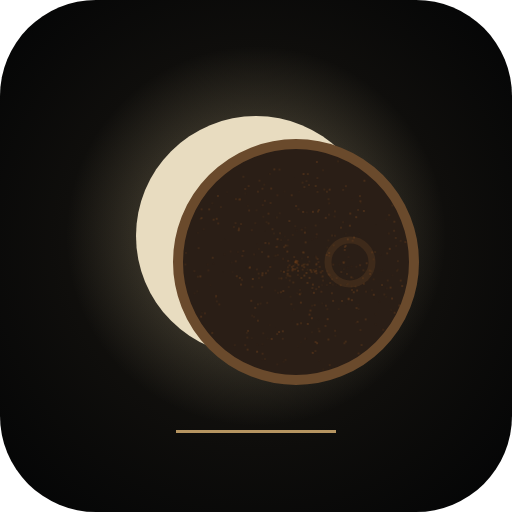
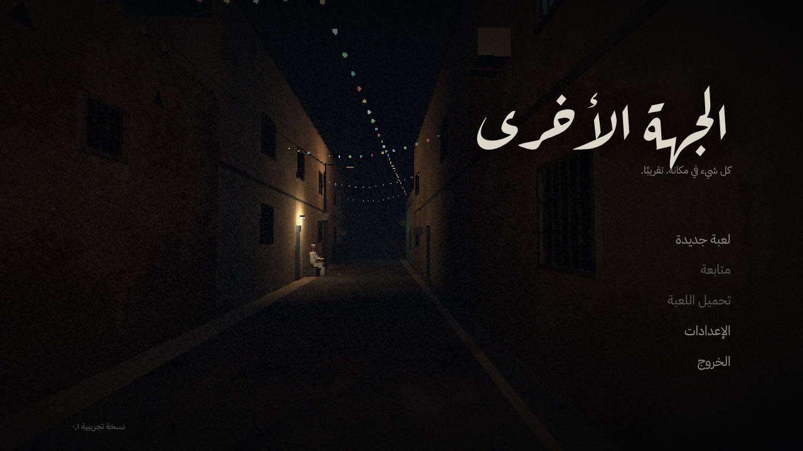
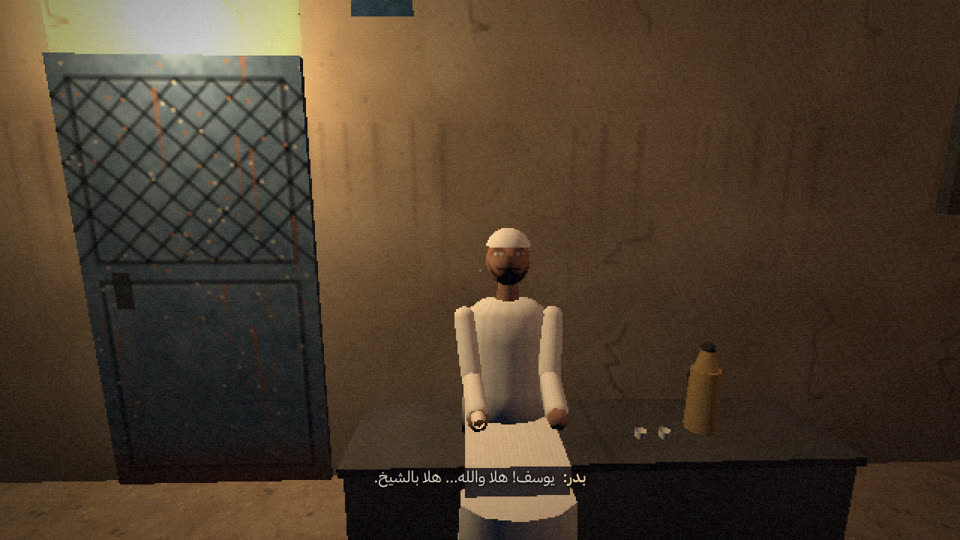
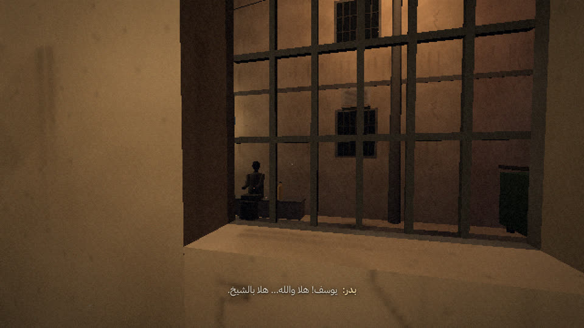
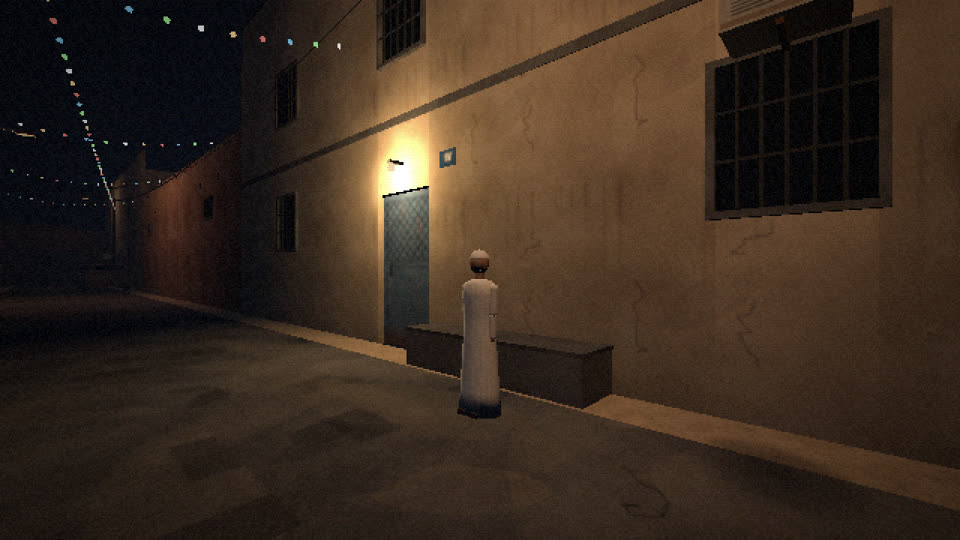
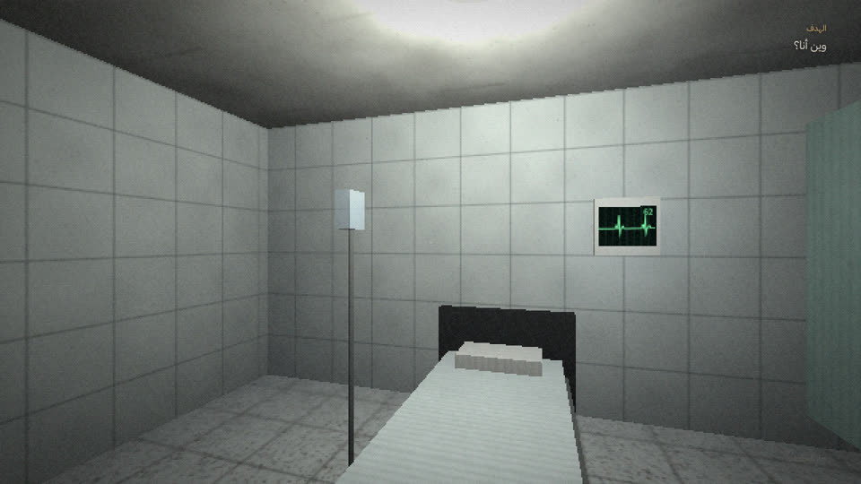

# الجهة الأخرى

**لعبة رعب نفسي وغموض في حارة سعودية قديمة**

كل شي في مكانه. تقريبًا.

## القصة
يوسف يرجع لبيت أهله في **حارة السدرة** بعد حادث. صديق طفولته بدر ينتظره عند عتبة بيتهم بالقهوة… وأخوه التوأم بندر رجع للحارة بعد غياب.
بس بدر ما عاد يصب القهوة بيمينه. والساعة واقفة على ٣:١٧. والفجر ما يأذّن.

**مين اللي قدامك؟**

 
 

| | |
|---|---|
| 🌙 **سبع ليالٍ وثلاث نهايات** | قصة كاملة، وكل نهاية لها معنى |
| 🏘️ **حارة سعودية** | أبواب نجدية، مكيفات شباك، بقالة، مسجد، سدرة، زينة رمضان |
| 🗣️ **باللهجة النجدية** | اللعبة كلها عربية |
| 🎧 **صوت حي** | أصوات وموسيقى على مقام الصبا |
| 🔄 **يحدّث نفسه** | التحديثات تنزل لحالها |

## التثبيت
1. اضغط زر **تحميل** فوق.
2. شغّل الملف، وتنفتح اللعبة مباشرة.
3. إذا طلع تنبيه Windows SmartScreen، اختر «More info» ثم «Run anyway».

**التحكم:** ‎W A S D‎ للمشي · ‎Shift‎ للركض · الفأرة للنظر · ‎E‎ للتفاعل · ‎F‎ الكشاف · ‎Esc‎ للإيقاف · ‎F11‎ ملء الشاشة

---

© MATRIX

